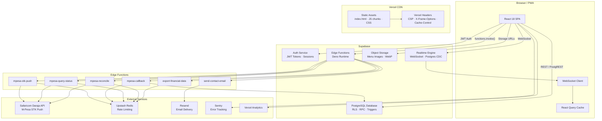
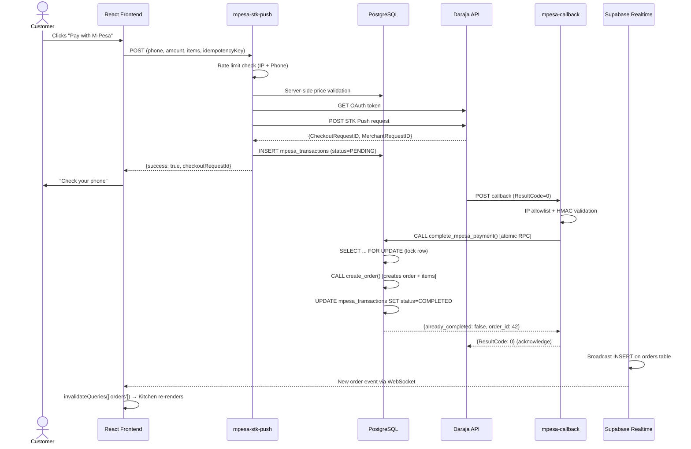
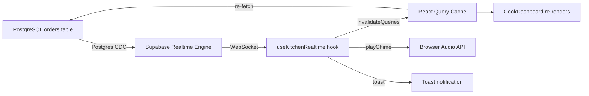
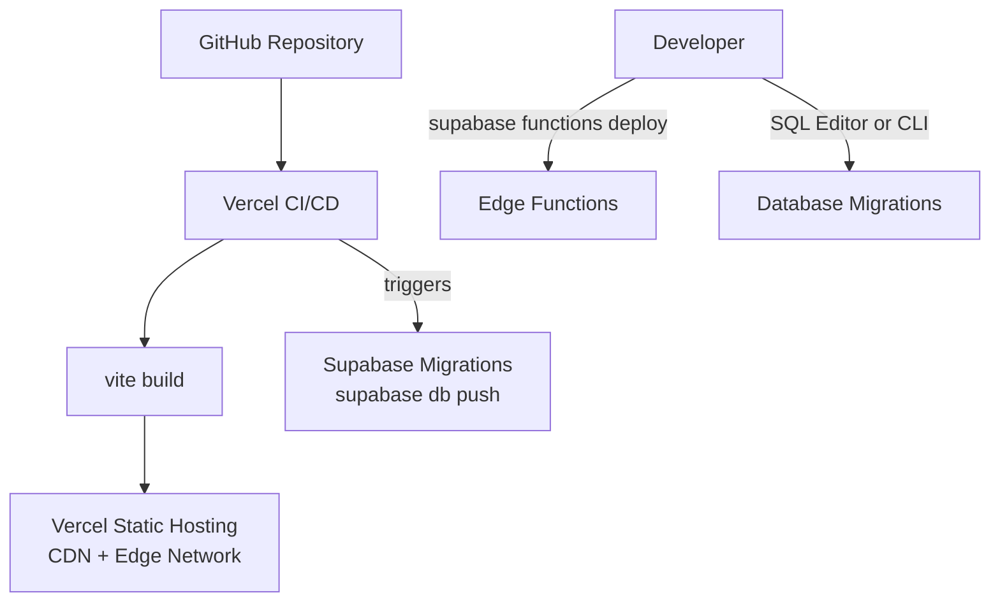

## Overview

Mlami BBQ follows a **serverless, API-first architecture**. There is no dedicated application server. All compute lives either in the browser (React SPA) or in Supabase's managed infrastructure (PostgreSQL, Edge Functions, Realtime).

---

## High-Level Architecture Diagram



---

## Frontend Architecture

### Provider Hierarchy

The React component tree wraps the application in a strict hierarchy of context providers:

```
ErrorBoundary
└─ QueryClientProvider        (React Query — global cache)
   └─ TooltipProvider         (Radix UI tooltip context)
      └─ BrowserRouter        (React Router v6 SPA navigation)
         └─ AuthProvider      (Supabase session + role state)
            └─ CartProvider   (Shopping cart in React state)
               └─ AppRoutes   (Route definitions + ProtectedRoute guard)
```

**Source:** `src/App.tsx:155-172`

### Route Structure

| Route | Component | Protection |
|-------|-----------|------------|
| `/` | `Index` | Public |
| `/menu` | `Menu` | Public |
| `/about` | `About` | Public |
| `/contact` | `Contact` | Public |
| `/reservation` | `Reservation` | Public |
| `/login` | `Login` | Public |
| `/privacy-policy` | `PrivacyPolicy` | Public |
| `/terms-of-service` | `TermsOfService` | Public |
| `/admin` | `Admin` | **ProtectedRoute** (admin \| cook \| waiter) |
| `*` | `NotFound` | Public |

All routes use `React.lazy()` + `Suspense` for automatic code splitting. Each lazy boundary shows a `PageSkeleton` variant while loading.

### Code Splitting Strategy

Chunks are manually grouped in `vite.config.ts` for optimal cache behavior:

| Chunk Name | Contents | Cache Strategy |
|-----------|----------|----------------|
| `vendor-react` | react, react-dom, react-router-dom | Long-lived (rare changes) |
| `vendor-supabase` | @supabase/supabase-js | Long-lived |
| `vendor-motion` | framer-motion | Long-lived |
| `vendor-query` | @tanstack/react-query | Long-lived |
| `vendor-radix` | All @radix-ui/* packages | Long-lived |
| `vendor-charts` | recharts | Admin-only (lazy) |
| `vendor-pdf` | jspdf, jspdf-autotable | Admin-only (lazy) |

**Source:** `vite.config.ts:77-115`

---

## Backend Architecture

### Supabase as Backend

Supabase provides all backend capabilities without a dedicated server:

| Capability | Supabase Feature | Usage |
|-----------|-----------------|-------|
| Database | PostgreSQL + PostgREST | All data storage |
| Authentication | Auth (JWT) | Staff login, session management |
| File storage | Object Storage | Menu item images |
| Real-time | Realtime Engine (WebSocket + Postgres CDC) | Kitchen order notifications |
| Serverless compute | Edge Functions (Deno) | M-Pesa, email, export |
| Row-level security | RLS Policies | Authorization on every table |
| Stored procedures | PL/pgSQL RPCs | Atomic payment + order operations |

### Edge Function Architecture

Each Edge Function is a standalone Deno module deployed to Supabase's global network:

```
supabase/functions/
├─ _shared/
│  ├─ rateLimiter.ts   ← Upstash Redis sliding-window rate limiter
│  └─ cors.ts          ← CORS helper used by all functions
├─ mpesa-stk-push/     ← Initiates payment, validates price, records transaction
├─ mpesa-callback/     ← Receives Safaricom webhook, atomically completes order
├─ mpesa-query-status/ ← Queries Daraja for payment status (used by frontend polling)
├─ mpesa-reconcile/    ← Background job: settles stale PENDING transactions
├─ export-financial-data/ ← Generates and streams CSV export (admin only)
└─ send-contact-email/ ← Sends contact/reservation emails via Resend
```

---

## Data Flow: Payment



---

## Realtime Architecture



The `useKitchenRealtime` hook subscribes to **both INSERT and UPDATE events** on the `orders` table. It uses a **2.5-second debounce** window to batch rapid state changes before triggering React Query cache invalidation, preventing excessive re-renders.

**Source:** `src/hooks/useKitchenRealtime.ts`

---

## Security Architecture

```mermaid
graph TB
    subgraph "Browser"
        CSP[Content-Security-Policy Headers]
        XFO[X-Frame-Options: DENY]
        RP[Referrer-Policy: strict-origin]
    end

    subgraph "API Layer"
        RL[Redis Rate Limiting<br/>Per-IP · Per-Phone]
        CORS[CORS Allowlist<br/>mlamibbq.com only]
        IP_AL[Safaricom IP Allowlist<br/>12 production IPs]
        HMAC[HMAC-SHA256 Signature Verification<br/>Callback authenticity]
    end

    subgraph "Database"
        RLS[Row-Level Security<br/>Every table]
        RBAC[has_role() function<br/>SECURITY DEFINER]
        SD[SECURITY DEFINER RPCs<br/>Controlled privilege escalation]
    end
```

---

## Deployment Architecture



Environment variables are injected at **build time** for `VITE_*` variables (baked into the JavaScript bundle) and at **runtime** for Edge Function secrets (stored in Supabase Vault / Dashboard).
