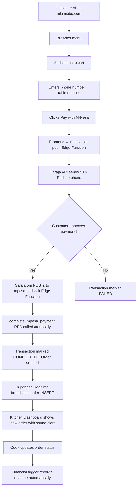

**Mlami BBQ** is a full-stack restaurant management platform built for an authentic Kenyan BBQ restaurant. It is simultaneously a customer-facing ordering website and an internal operations system for all restaurant staff.

---

## Business Problem

Running a busy BBQ restaurant involves several overlapping challenges that manual processes and generic POS systems cannot address well:

| Problem | Impact Without a System |
|---------|------------------------|
| Customers cannot browse the menu or pay digitally | Lost revenue, long queues, poor experience |
| Kitchen staff have no live view of incoming orders | Missed orders, customer complaints |
| Payments via M-Pesa require manual reconciliation | Accounting errors, fraud risk |
| Admin has no financial visibility | No data-driven decisions |
| Multiple staff types need different system access | Security and operational risk |
| Reservations and customer contact management is ad-hoc | Lost bookings, missed follow-ups |

Mlami BBQ solves every one of these problems in a single, cohesive platform.

---

## Target Users

### 1. Customers (Public)
- Browse the full menu with categories, prices, and availability
- Add items to cart
- Pay with M-Pesa STK Push from their phone
- Make table reservations online
- Send contact enquiries

### 2. Kitchen Cooks
- See incoming orders in real-time with sound alerts
- Update order status (Pending → Preparing → Ready → Completed)
- Manage menu item stock/availability
- Generate QR codes for tables

### 3. Waiters
- Record manual sales (cash, card, bank transfer, manual M-Pesa)
- View personal sales history
- See all orders

### 4. Admin
- Full access to everything above
- Financial dashboard (revenue, expenses, refunds)
- Export financial reports (CSV, PDF, JSON)
- User management and role assignment
- Manage reservations and contact messages
- M-Pesa reconciliation panel
- Add/edit/remove menu items

---

## Core Features

### Customer-Facing
- ✅ Animated home page with hero, popular dishes, and about section
- ✅ Full menu page with category filtering and stock indicators
- ✅ Shopping cart with quantity management
- ✅ M-Pesa STK Push checkout flow
- ✅ Table reservation form (stored + email notification)
- ✅ Contact form (stored + email notification)
- ✅ Privacy policy and terms of service pages
- ✅ Progressive Web App (installable, offline-capable)
- ✅ Fully responsive (mobile-first design)

### Operations (Admin Panel at `/admin`)
- ✅ Real-time orders view with live status updates and sound notifications
- ✅ Kitchen dashboard (cook-specific, order card workflow)
- ✅ Inventory (stock toggle per menu item)
- ✅ QR code generator for tables
- ✅ Financial dashboard (revenue/expense/profit tracking)
- ✅ Manual sales recording (cash, card, bank transfer, M-Pesa)
- ✅ Refund processing with audit trail
- ✅ Data export (CSV via Edge Function, PDF, JSON, text report)
- ✅ M-Pesa reconciliation panel
- ✅ User management with role assignment
- ✅ Contact messages inbox
- ✅ Reservations list
- ✅ Waiter personal sales history

---

## Overall Workflow

---

## Non-Functional Goals

| Goal | How It Is Achieved |
|------|--------------------|
| **Security** | RLS, RBAC, HMAC callback verification, IP allowlist, rate limiting, CSP headers |
| **Reliability** | Idempotent payments, atomic RPCs, background reconciliation job |
| **Performance** | Code splitting, lazy loading, React Query caching, PWA, Brotli/Gzip compression |
| **Scalability** | Stateless Edge Functions, Supabase managed infra, distributed Redis rate limiting |
| **Maintainability** | TypeScript throughout, modular architecture, centralized permissions library |
| **Observability** | Sentry error tracking, structured JSON logging in Edge Functions, Vercel Analytics |
