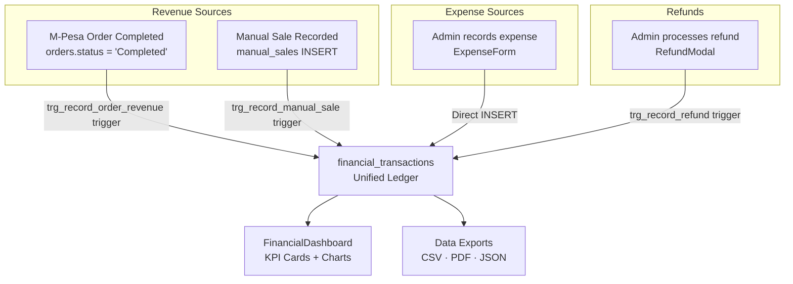

## Overview

The financial module provides complete visibility into restaurant revenue, expenses, and profitability. It is **admin-only** and tracks three types of financial events:

1. **Revenue** — from M-Pesa orders (automatic) and manual sales (by admin/waiter)
2. **Expenses** — manually recorded by admin (ingredients, rent, utilities, etc.)
3. **Refunds** — recorded by admin, deducted from net profit

All amounts are stored as **integer cents** and displayed as `KES X.XX`.

---

## Architecture



---

## Database Tables

### `financial_transactions` — The Ledger

The central table for all financial events. See [Database](./05-database.md#financial_transactions) for full schema.

Key design: `transaction_type` has a CHECK constraint: `revenue | expense | refund`

### `manual_sales` — Manual Revenue

Tracks cash/card/bank/manual-M-Pesa sales that aren't captured by the STK Push flow. See [Database](./05-database.md#manual_sales).

### `refunds` — Issued Refunds

Tracks refunds with a reference to the original sale and the reason. See [Database](./05-database.md#refunds).

---

## Automatic Revenue Recording

### M-Pesa Orders → Revenue

When a cook marks an order as `Completed`, a trigger automatically records revenue:

```sql
-- Migration: 20260625_critical_concurrency_and_standardization.sql
CREATE OR REPLACE FUNCTION public.record_order_revenue()
RETURNS TRIGGER AS $$
BEGIN
  IF NEW.status = 'Completed' AND OLD.status != 'Completed' THEN
    INSERT INTO financial_transactions (
      transaction_date, transaction_type, category, amount, description, order_id
    ) VALUES (
      CURRENT_DATE, 'revenue', 'food_orders', NEW.total,
      'Order #' || NEW.id || ' completed', NEW.id
    );
  END IF;
  RETURN NEW;
END;
$$;
```

> ⚠️ **Important:** The trigger fires on `'Completed'` (PascalCase). If order status is set to `'completed'` (lowercase), the trigger will NOT fire. All order status updates must use PascalCase.

### Manual Sales → Revenue

When a manual sale is inserted, a trigger creates a `financial_transactions` entry:

```sql
INSERT INTO financial_transactions (
  transaction_date, transaction_type, category, amount, description,
  recorded_by, recorded_by_name
) VALUES (
  NEW.sale_date, 'revenue',
  COALESCE(NEW.category, 'food_orders'),
  NEW.amount,
  'Manual sale (' || NEW.payment_method || ' · ' || NEW.order_type || ')'
    || CASE WHEN NEW.notes != '' THEN ' — ' || NEW.notes ELSE '' END,
  NEW.recorded_by, NEW.recorded_by_name
);
```

### Refunds → Refund Entry

When a refund is inserted, a trigger records it as a negative event in `financial_transactions`:

```sql
INSERT INTO financial_transactions (
  transaction_date, transaction_type, category, amount, description,
  recorded_by, recorded_by_name
) VALUES (
  NEW.refund_date, 'refund', 'refund', NEW.refund_amount,
  'Refund (Ref: ' || NEW.original_sale_ref || ') — ' || NEW.reason,
  NEW.processed_by, NEW.processed_by_name
);
```

---

## Hooks

### `useFinancialData(period, category)`
**File:** `src/hooks/useFinancialData.tsx`

Fetches `financial_transactions` filtered by date range and optional category. Returns:
- `transactions`: Array of transaction records
- `summary`: `{ totalRevenue, totalExpenses }`
- `categories`: Unique category list for the filter dropdown
- `isLoading`: Boolean

```typescript
const { transactions, summary } = useFinancialData('monthly', 'all');
```

### `useManualSales(period)`
**File:** `src/hooks/useManualSales.ts`

Fetches the total amount from `manual_sales` for the given period. Used separately from `useFinancialData` because manual sales have a different date column (`sale_date` vs `transaction_date`).

### `useRefunds(period)`
**File:** `src/hooks/useRefunds.ts`

Fetches the total refund amount for the given period from the `refunds` table.

### `useStatsCardSummary()`
**File:** `src/hooks/useStatsCardSummary.ts`

Calls the `get_dashboard_stats()` RPC to get all dashboard KPIs in a single efficient query. Returns active orders, completed today, total revenue (including manual sales), and trend percentages.

---

## Components

### `ManualSaleModal`
**File:** `src/components/admin/financial/ManualSaleModal.tsx`

Admin-facing modal for recording a manual sale. Fields:
- Amount (KES)
- Payment method: `cash | card | bank_transfer | mpesa_manual`
- Order type: `dine_in | takeaway | delivery`
- Category (defaults to `food_orders`)
- Notes
- Sale date (defaults to today)

On submit: Fetches current user's name from `profiles`, then INSERTs to `manual_sales` with `recorded_by = user.id` and `recorded_by_name`.

### `WaiterRecordSale`
**File:** `src/components/admin/WaiterRecordSale.tsx`

Waiter-specific version of the manual sale form. RLS ensures the waiter can only record sales for themselves.

### `ExpenseForm`
**File:** `src/components/admin/financial/ExpenseForm.tsx`

Admin form for recording expenses. Directly inserts into `financial_transactions` with `transaction_type = 'expense'`.

### `RefundModal`
**File:** `src/components/admin/financial/RefundModal.tsx`

Admin modal for issuing refunds. Inserts into `refunds` table. The `trg_record_refund` trigger then creates the `financial_transactions` entry automatically.

### `MpesaReconciliationPanel`
**File:** `src/components/admin/financial/MpesaReconciliationPanel.tsx`

Shows:
- Current count of PENDING M-Pesa transactions
- Comparison with internal revenue (gap analysis)
- "Reconcile Now" button (triggers `mpesa-reconcile` Edge Function)
- Results summary after reconciliation

---

## Data Exports

### CSV Export (via Edge Function)
- Calls `export-financial-data` Edge Function with JWT
- Server-side RBAC check (`has_role(user.id, 'admin')`)
- Returns CSV stream with `Content-Disposition: attachment; filename=...`
- Amounts converted from cents to KES before export

### PDF Export (Client-side, jsPDF)
- Generated entirely in the browser using `src/utils/pdfExport.ts`
- Includes summary table and transaction list
- No server round-trip needed

### JSON Export (Client-side)
- Raw transactions array serialized to JSON
- Downloaded as `.json` file via blob URL

### Text Report (Client-side)
- Human-readable plain text summary
- Period, totals, category breakdown
- Downloaded as `.txt` file

---

## Net Profit Calculation

```typescript
const netProfit = summary.totalRevenue - summary.totalExpenses - totalRefunds;
const mpesaRevenue = summary.totalRevenue - totalManualSales;
```

- **Total Revenue** = M-Pesa order revenue + manual sales revenue (both in `financial_transactions`)
- **Total Expenses** = Sum of `expense` type entries
- **Refunds** = Fetched from `refunds` table directly (not subtracted from revenue entries in the ledger — they are separate line items)
- **Net Profit** = Revenue - Expenses - Refunds

---

## Audit Trail

Every financial transaction has `recorded_by` (UUID) and `recorded_by_name` (TEXT). These fields are:
- Set automatically by triggers for M-Pesa orders (no user attribution for automated events)
- Set explicitly from the authenticated user's profile for manual sales, expenses, and refunds

The `recorded_by_name` is displayed in the transaction feed to make it clear who recorded each entry. This satisfies basic audit trail requirements for restaurant accounting.

---

## Period Filtering

| Period | Date Range |
|--------|-----------|
| Daily | Today (midnight to now) |
| Weekly | Last 7 days |
| Monthly | First day of current month to now |
| Yearly | First day of current year to now |

The `useFinancialData` hook applies a `.gte('transaction_date', startDate)` filter. The `export-financial-data` Edge Function applies the same logic server-side for CSV exports.
