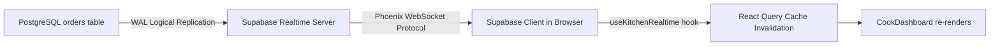

## Overview

Mlami BBQ uses **Supabase Realtime** to broadcast live order updates to the Kitchen Dashboard. When a customer completes an M-Pesa payment and an order is created, kitchen staff see the new order card appear within seconds — with a sound notification.

---

## How Supabase Realtime Works



Supabase Realtime uses **Postgres Change Data Capture (CDC)** via PostgreSQL's Write-Ahead Log (WAL). Every INSERT, UPDATE, and DELETE on subscribed tables is streamed to connected clients in real-time via WebSocket.

The `orders` table must have `REPLICA IDENTITY` set to `FULL` or `DEFAULT` in Supabase for CDC to work correctly. This is configured via the Supabase Dashboard (Database → Replication).

---

## Implementation: `useKitchenRealtime`

**File:** `src/hooks/useKitchenRealtime.ts`

```typescript
const channel = supabase
  .channel('kitchen-orders-realtime')
  .on(
    'postgres_changes',
    { event: 'INSERT', schema: 'public', table: 'orders' },
    (payload) => {
      triggerInvalidations();
      if (newOrder.status === 'Pending') {
        playChime('new-order');
        toast({ title: '🔔 New Order!', description: `Table #${table} — Order #${id}` });
      }
    }
  )
  .on(
    'postgres_changes',
    { event: 'UPDATE', schema: 'public', table: 'orders' },
    (payload) => {
      triggerInvalidations();
      playChime('status-change');
      toast({ title: 'Order Updated', description: `Order #${id} → ${status}` });
    }
  )
  .subscribe((status) => setIsConnected(status === 'SUBSCRIBED'));
```

### Subscription Events

| Event | Trigger | Action |
|-------|---------|--------|
| `INSERT` on `orders` | New payment completed | Invalidate cache + chime + toast |
| `UPDATE` on `orders` | Status changed by cook | Invalidate cache + blip + toast |

### Connection Status

The `isConnected` boolean returned by the hook is displayed as a live indicator in the Kitchen Dashboard (green dot = connected, grey = disconnected).

---

## Cache Invalidation Strategy

When a Realtime event fires, the hook **does not immediately update React state** with the event payload. Instead, it **invalidates React Query caches** and lets React Query refetch from the database. This approach has several advantages:

1. **Single source of truth:** Data always comes from the database, not WebSocket payloads
2. **Correctness:** The Realtime payload may not include all joined fields that the UI needs
3. **Automatic pagination:** React Query can refetch the correct page/filters
4. **Error handling:** If the refetch fails, React Query's retry logic kicks in

```typescript
const triggerInvalidations = () => {
  // Debounce: batch rapid events into a single refetch
  debounceTimerRef.current = setTimeout(() => {
    queryClient.invalidateQueries({ queryKey: ['orders'] });
    queryClient.invalidateQueries({ queryKey: ['orders-summary'] });
    queryClient.invalidateQueries({ queryKey: ['stats-summary'] });
  }, 2500); // 2.5-second debounce window
};
```

### Debounce Strategy

A 2.5-second debounce timer batches rapid consecutive events (e.g., a cook quickly updating multiple orders) into a single database refetch, preventing excessive API calls.

---

## Kitchen Sound System

**File:** `src/lib/kitchenSound.ts`

Kitchen sounds are generated programmatically using the **Web Audio API** — no audio files are required.

```typescript
// 'new-order': 3-note ascending chime (happy alert)
// 'status-change': short single blip (status ping)
export function playChime(type: 'new-order' | 'status-change') { ... }
```

Sound is only played when the cook enables it (toggle stored in `useKitchenSound` hook). The sound state is read via a stable `ref` inside the Realtime callback, so toggling sound does **not** cause the WebSocket channel to be re-created.

```typescript
// Sound enabled ref — updated without causing re-subscription
const soundEnabledRef = useRef(soundEnabled);
useEffect(() => { soundEnabledRef.current = soundEnabled; }, [soundEnabled]);
```

---

## React Query Integration

The kitchen dashboard uses `useLightOrders` for efficient data fetching:

```typescript
// src/hooks/useLightOrders.ts
// Uses a custom RPC for a lighter payload (no heavy joins)
const { data } = useQuery({
  queryKey: ['orders'],
  queryFn: () => supabase.rpc('get_light_orders'),
  staleTime: 30_000, // 30 seconds — Realtime handles freshness
});
```

React Query's `staleTime` is set to 30 seconds for orders. In practice, the Realtime subscription triggers invalidation much faster — the staleTime is a fallback safety net.

---

## Channel Lifecycle

The Realtime channel is created once when the `CookDashboard` mounts and cleaned up when it unmounts:

```typescript
useEffect(() => {
  const channel = supabase.channel('kitchen-orders-realtime')
    .on(...).subscribe();
  
  return () => {
    clearTimeout(debounceTimerRef.current);
    supabase.removeChannel(channel);
    setIsConnected(false);
  };
}, [queryClient, toast]); // stable deps — won't cause reconnects
```

**Why `queryClient` and `toast` in deps?** Both are stable references (the QueryClient instance is created once in `App.tsx`, and `useToast` returns a stable function). Including them satisfies the `exhaustive-deps` ESLint rule without causing re-subscriptions.

---

## Performance Considerations

| Concern | How Addressed |
|---------|--------------|
| Too many re-renders on rapid events | 2.5s debounce on cache invalidation |
| Sound toggle causing reconnects | Sound state accessed via stable ref |
| Channel not cleaned up | Cleanup in `useEffect` return function |
| Stale data if Realtime disconnects | `staleTime: 30s` means React Query refetches on window focus |
| Heavy payload from Realtime | Only cache keys invalidated; actual data fetched via optimized RPC |

---

## Realtime in Other Parts of the Application

Currently, Supabase Realtime is only used in the Kitchen Dashboard (Cook view). Future enhancements could extend realtime to:

- Customer-facing order status tracking page
- Admin orders view for live order count updates
- Financial dashboard for live revenue updates

See [Future Roadmap](./19-future-roadmap.md).
