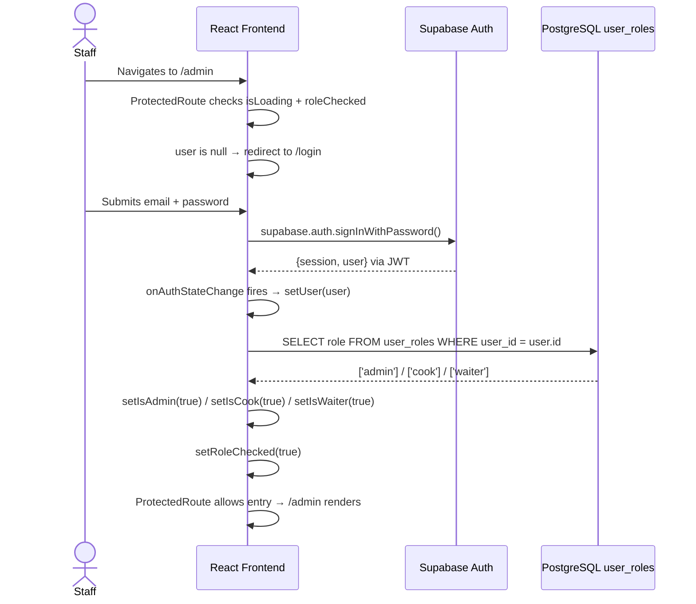

## Overview

Authentication is handled entirely by **Supabase Auth** using email/password. Role-based access control (RBAC) is implemented at three layers:

1. **Frontend route guard** (`ProtectedRoute` in `App.tsx`)
2. **Component-level view control** (`Admin.tsx` `useEffect` guard)
3. **Database RLS policies** (enforced by PostgreSQL regardless of frontend code)

---

## Authentication Flow



**Source:** `src/contexts/auth/useAuthProvider.tsx`

---

## Session Management

Supabase Auth uses **JWT tokens** stored in `localStorage` (default Supabase behavior). The token is automatically refreshed before expiry by the Supabase client.

```typescript
// Session initialized once on mount
const { data } = await supabase.auth.getSession();
setSession(data.session);
setUser(data.session?.user ?? null);

// Persistent listener updates state on tab focus, token refresh, sign-out
supabase.auth.onAuthStateChange((event, session) => {
  setSession(session);
  setUser(session?.user ?? null);
  if (event === 'SIGNED_OUT') { /* clear roles, redirect home */ }
});
```

**Key Design:** The auth listener is set up once with empty deps (`[]`) and accesses `navigate`/`toast` via **stable refs**, preventing unnecessary re-subscriptions on re-renders.

---

## Role Checking

After a user is authenticated, their roles are fetched from `public.user_roles`:

```typescript
const { data: rolesData } = await supabase
  .from('user_roles')
  .select('role')
  .eq('user_id', user.id);

const fetchedRoles = rolesData?.map(r => r.role) as AppRole[];
setIsAdmin(fetchedRoles.includes('admin'));
setIsCook(fetchedRoles.includes('cook'));
setIsWaiter(fetchedRoles.includes('waiter'));
```

The `roleChecked` boolean prevents the protected route from rendering until roles are confirmed. This avoids a flash of incorrect content during the async role check.

---

## Auth Context API

The `useAuth()` hook exposes:

```typescript
interface AuthContext {
  user: User | null;
  session: Session | null;
  signIn: (email: string, password: string) => Promise<void>;
  signOut: () => Promise<void>;
  isLoading: boolean;
  isAdmin: boolean;
  isCook: boolean;
  isWaiter: boolean;
  roles: AppRole[];
  hasPermission: (permission: Permission) => boolean;
  roleChecked: boolean;
}
```

---

## Roles and Permissions

Roles are defined as a PostgreSQL enum: `app_role = 'admin' | 'cook' | 'waiter' | 'user'`

The central permissions library is at `src/lib/permissions.ts`:

```typescript
export type AppRole = 'admin' | 'cook' | 'waiter' | 'user';

export type Permission =
  | 'orders.view'
  | 'orders.update_status'
  | 'sales.record'
  | 'sales.view_own'
  | 'sales.view_all'
  | 'financials.view'
  | 'expenses.manage'
  | 'users.manage'
  | 'kitchen.view'
  | 'inventory.view'
  | 'qrcodes.manage';
```

### Permission Matrix

| Permission | Admin | Cook | Waiter |
|-----------|-------|------|--------|
| `orders.view` | ✅ | ✅ | ✅ |
| `orders.update_status` | ✅ | ✅ | ❌ |
| `sales.record` | ✅ | ❌ | ✅ |
| `sales.view_own` | ✅ | ❌ | ✅ |
| `sales.view_all` | ✅ | ❌ | ❌ |
| `financials.view` | ✅ | ❌ | ❌ |
| `expenses.manage` | ✅ | ❌ | ❌ |
| `users.manage` | ✅ | ❌ | ❌ |
| `kitchen.view` | ✅ | ✅ | ❌ |
| `inventory.view` | ✅ | ✅ | ❌ |
| `qrcodes.manage` | ✅ | ✅ | ❌ |

**Source:** `src/lib/permissions.ts:29-56`

---

## Protected Route

The `ProtectedRoute` component in `src/App.tsx` guards `/admin`:

```typescript
const ProtectedRoute = ({ children, requireAdmin, requireCook }) => {
  const { user, isLoading, isAdmin, isCook, isWaiter, roleChecked } = useAuth();
  
  if (isLoading || !roleChecked) return <LoadingPage />;
  if (!user) return <Navigate to="/login" />;
  
  const isAnyStaff = isAdmin || isCook || isWaiter;
  if (!isAnyStaff) return <Navigate to="/" />;
  
  return <>{children}</>;
};
```

---

## View-Level Route Guard

Inside `Admin.tsx`, a `useEffect` enforces which views each role can access:

```typescript
const waiterViews    = ['orders', 'record-sale', 'my-sales'];
const cookViews      = ['dashboard', 'orders', 'cook', 'inventory', 'qrcodes'];
const adminOnlyViews = ['financial', 'users', 'reservations', 'contact'];

if (isWaiter && !isAdmin && !isCook) {
  if (!waiterViews.includes(activeView)) setActiveView('orders');
}
if (isCook && !isAdmin) {
  if (!cookViews.includes(activeView)) setActiveView('cook');
}
```

Additionally, in `viewConfig`, sensitive views conditionally return `null` if the user lacks the required role:

```typescript
financial: { content: isAdmin ? <FinancialDashboard /> : null }
users:     { content: isAdmin ? <UserRoles /> : null }
```

---

## Sidebar Navigation Filtering

`AdminSidebar.tsx` reads the `hasPermission` function from the auth context and only renders sidebar items the current user has access to. This ensures the sidebar never displays links to views the user cannot use.

---

## Database-Level Authorization (RLS)

RLS policies use the `has_role()` SECURITY DEFINER function to authorize data access independently of the frontend:

```sql
-- Example: Only admins can see financial transactions
CREATE POLICY "Only admins can access financial transactions"
  ON public.financial_transactions
  FOR ALL
  TO authenticated
  USING (public.has_role(auth.uid(), 'admin'))
  WITH CHECK (public.has_role(auth.uid(), 'admin'));
```

The `has_role()` function is `STABLE` and `SECURITY DEFINER` — it reads from `user_roles` with elevated privilege, making it safe to call from policies without granting users direct access to the `user_roles` table.

---

## Security Considerations

### Preventing User Enumeration
The `signIn` error handler uses a **generic error message**:
```typescript
toast({ description: 'Invalid email or password. Please try again.' })
```
This prevents an attacker from determining which email addresses are registered.

### Dual-Layer Authorization
Even if a frontend bug allows a waiter to navigate to the Financial Dashboard URL, the RLS policy on `financial_transactions` will return zero rows — the data never leaves the database.

### Role Refresh
If an admin demotes a user while they are logged in, the old role flags remain in memory until the next login or page refresh. This is an accepted trade-off for simplicity. For higher security environments, real-time role refresh via Supabase Realtime on the `user_roles` table should be implemented (see [Future Roadmap](./19-future-roadmap.md)).

### No Privileged Keys in Browser
The frontend only uses the **anon key** (`VITE_SUPABASE_ANON_KEY`). The service role key is exclusively used in Edge Functions where it is stored as a server-side secret.
