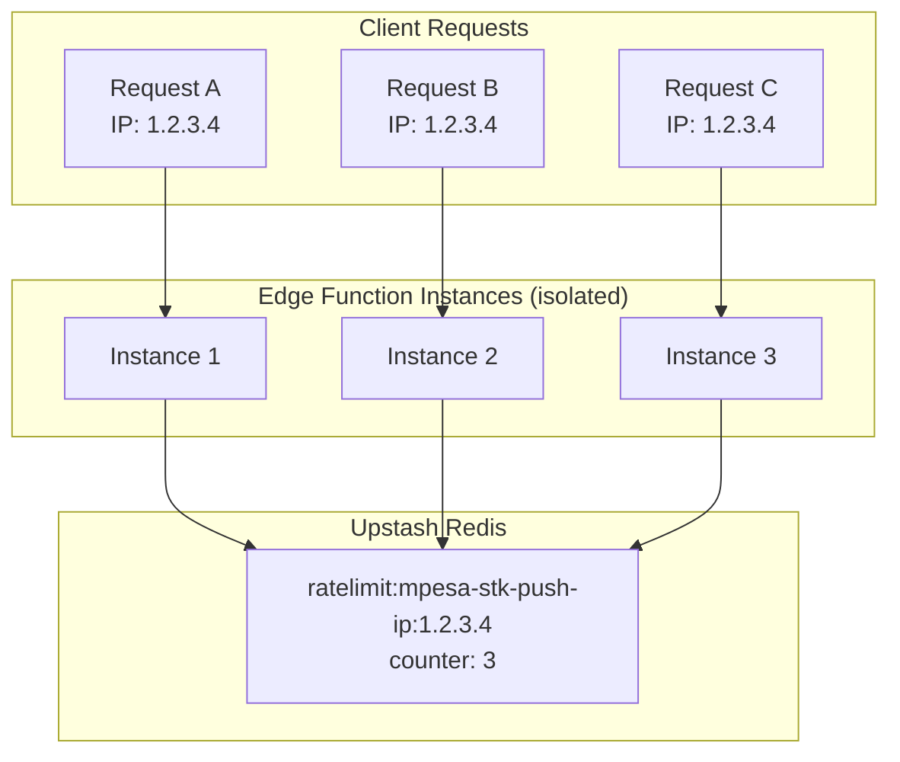
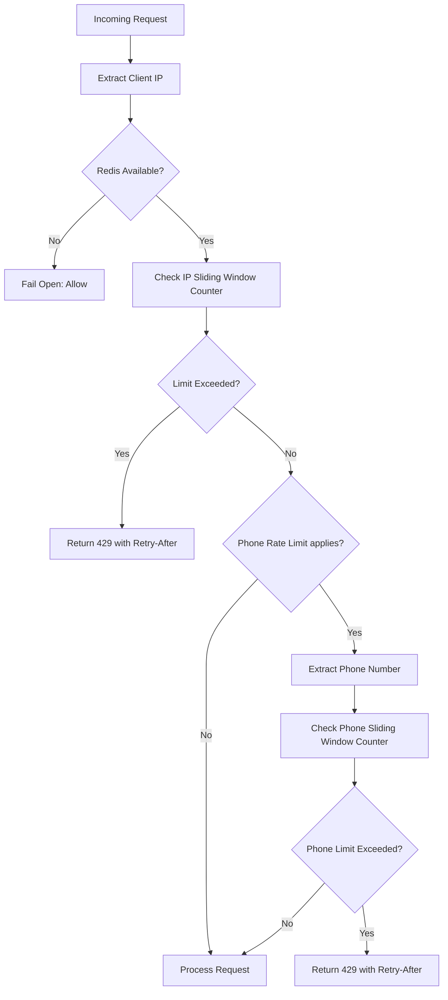

## Overview

Mlami BBQ uses **distributed rate limiting** backed by **Upstash Redis** to protect all Edge Function endpoints from abuse, excessive Daraja API calls, and brute-force attacks.

---

## Why Distributed Rate Limiting?

Edge Functions are **stateless and ephemeral**. Each function invocation is a separate isolated process with no shared memory. This makes in-memory rate limiting impossible — every invocation starts fresh with no knowledge of previous requests.

**Upstash Redis** solves this by providing a serverless, globally distributed Redis instance. All function instances write to the same Redis store, so rate limit counters are shared across all concurrent invocations.



---

## Implementation

**File:** `supabase/functions/_shared/rateLimiter.ts`

### Core Function

```typescript
export async function rateLimit(options: {
  identifier: string;  // IP address or phone number
  limit: number;       // Max requests per window
  window: string;      // e.g., "1 m", "5 m", "1 h"
  endpoint: string;    // Namespace prefix for Redis keys
}): Promise<RateLimitResult>
```

### Algorithm: Sliding Window

The `@upstash/ratelimit` library implements a **sliding window** counter. Unlike fixed-window counters that reset at regular intervals (creating burst opportunities at window boundaries), the sliding window smoothly distributes the rate limit across time.

**How it works:**
- Redis stores a sorted set of request timestamps per identifier
- Timestamps older than the window are expired and removed
- Current window count = length of the sorted set
- Atomically incremented on each request

```typescript
limiter = new Ratelimit({
  redis,
  limiter: Ratelimit.slidingWindow(options.limit, options.window),
  prefix: `ratelimit:${options.endpoint}`,
});
```

### Per-Isolate Caching

The `limiters` Map caches Ratelimit instances within the same Edge Function isolate:

```typescript
const limiters = new Map<string, Ratelimit>();
// Prevents creating a new Redis connection on every request within the same isolate
```

---

## Rate Limit Policies

| Endpoint | Identifier | Limit | Window | Config Variable |
|----------|-----------|-------|--------|-----------------|
| `mpesa-stk-push` | IP address | 5 | 1 minute | `RATE_LIMIT_STK_IP` |
| `mpesa-stk-push` | Phone number | 2 | 1 minute | `RATE_LIMIT_STK_PHONE` |
| `mpesa-query-status` | IP address | 30 | 1 minute | `RATE_LIMIT_QUERY` |
| `send-contact-email` | IP address | 5 | 1 minute | `RATE_LIMIT_EMAIL` |
| `export-financial-data` | IP address | 10 | 1 minute | `RATE_LIMIT_ADMIN` |
| `mpesa-reconcile` | IP address | 5 | 1 minute | `RATE_LIMIT_ADMIN` |

### Rationale for Limits

**STK Push (IP: 5/min):** A legitimate customer should rarely need more than 1-2 payment attempts per minute. 5 allows for transient retries while blocking automated abuse.

**STK Push (Phone: 2/min):** Tightest limit. A phone number should only need to initiate payment once per minute at most. This prevents a single compromised number from triggering many charges.

**Query Status (30/min):** Higher limit because the frontend polls this during the payment wait experience. Typical flow: ~1 poll per 3-5 seconds = ~12-20 requests per minute maximum.

**Email (5/min):** Prevents contact form spam.

---

## IP Extraction

```typescript
export function getClientIp(req: Request): string {
  const forwardedFor = req.headers.get("x-forwarded-for");
  if (forwardedFor) {
    return forwardedFor.split(",")[0].trim();
  }
  return req.headers.get("x-real-ip")?.trim() || "unknown-ip";
}
```

The first IP in `x-forwarded-for` is the original client IP (added by Vercel/Supabase's edge).

---

## Response Format

When a rate limit is exceeded, the function returns **HTTP 429** with:

```json
{
  "success": false,
  "message": "Too many requests. Please try again later.",
  "code": "RATE_LIMIT_EXCEEDED"
}
```

Response headers include:
```
X-RateLimit-Limit: 5
X-RateLimit-Remaining: 0
X-RateLimit-Reset: 1751598900000
Retry-After: 47
```

---

## Fail-Open Strategy

If Upstash Redis is **unavailable** (network error, maintenance), rate limiting is bypassed:

```typescript
if (!url || !token) {
  console.warn("Upstash Redis not configured. Rate limiting is disabled (Fail Open).");
  return { success: true, ... };
}

try {
  const res = await limiter.limit(identifier);
  return { success: res.success, ... };
} catch (error) {
  console.warn("Rate limiting failed, proceeding with Fail Open strategy.");
  return { success: true, ... };
}
```

**Rationale:** The business impact of dropping legitimate customer payments (because Redis is down) is worse than temporarily allowing more traffic. The underlying Daraja API has its own rate limits as a secondary protection layer.

---

## Request Lifecycle with Rate Limiting



---

## Configuration

Rate limits are configurable via environment variables (no code change required):

```bash
# In Supabase Dashboard → Edge Function Secrets
UPSTASH_REDIS_REST_URL="https://your-instance.upstash.io"
UPSTASH_REDIS_REST_TOKEN="your-token"

RATE_LIMIT_STK_IP="5"
RATE_LIMIT_STK_PHONE="2"
RATE_LIMIT_QUERY="30"
RATE_LIMIT_EMAIL="5"
RATE_LIMIT_ADMIN="10"
```

---

## Monitoring

When a rate limit is exceeded, a structured warning is logged:

```json
{
  "level": "WARN",
  "event": "rate_limit_exceeded",
  "endpoint": "mpesa-stk-push-ip",
  "identifier": "1.2.3.4",
  "limit": 5,
  "remaining": 0,
  "resetTime": 1751598900000
}
```

These logs are visible in the Supabase Dashboard under Functions → Logs. High rates of rate limit warnings should trigger investigation for potential attacks.

> ⚠️ **Note:** In production, mask the IP identifier in logs to avoid storing PII. Future improvement: log only the first 2 octets of IPv4 addresses.
